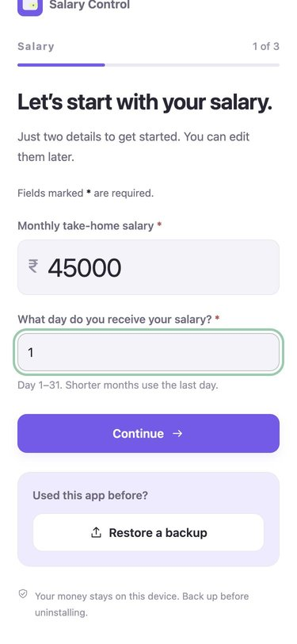
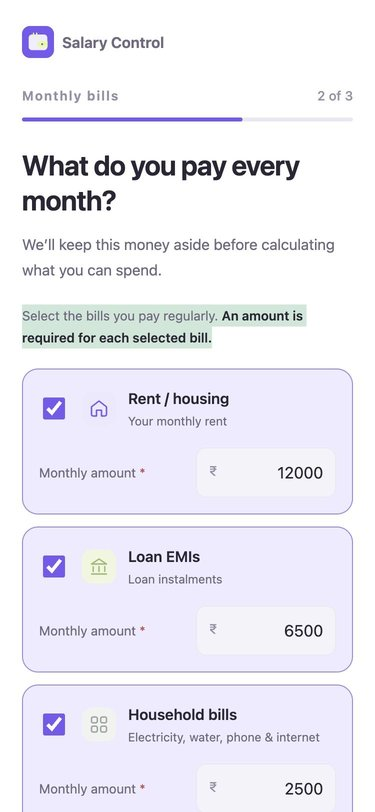
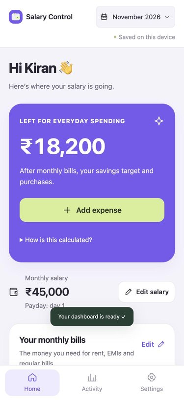
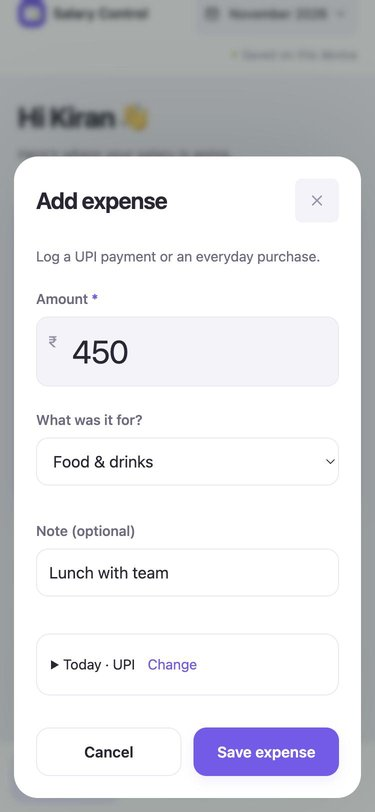
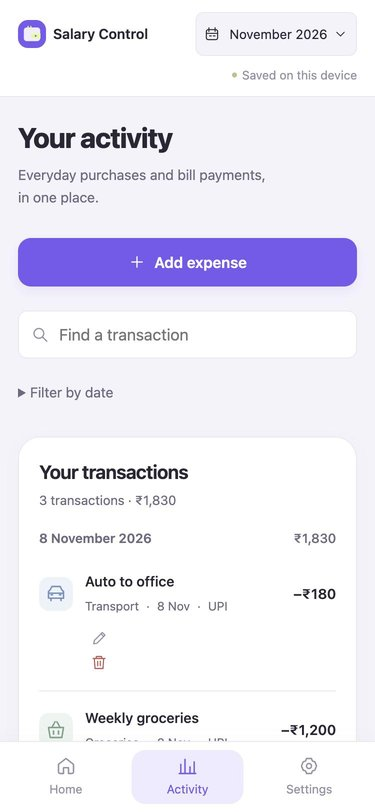

# Where Did My Salary Go? — Salary Control

A simple, private salary tracker for working people in India. Most of us get paid, pay our bills, and by month end have no idea where the rest went. Salary Control fixes that in three questions.

Built by **Kiran K P** with **Codex**.

🎬 **[Watch the 50-second demo](docs/demo.mp4)**

| Setup | Monthly bills | Dashboard | Add expense | Activity |
|---|---|---|---|---|
|  |  |  |  |  |

## What it does

- **3-step setup:** take-home salary and payday → fixed monthly bills (rent, EMIs, household, subscriptions, insurance, family support) → savings target.
- **"Left for everyday spending":** one clear number after bills and savings are set aside.
- **Add expenses in seconds:** amount, category and note, with "Today · UPI" pre-filled.
- **Activity:** every transaction by day, with search and date filters.
- **Goals, loans and subscriptions:** plan a purchase, track EMIs, review recurring payments.
- **Private by design:** financial data is encrypted on the device, with password-protected backup files you can restore anytime.

## Run it locally

No build step and no dependencies. You only need Python 3.

```bash
git clone https://github.com/<your-username>/where-did-my-salary-go.git
cd where-did-my-salary-go
python3 dev-server.py
```

Then open http://localhost:8000 (use your browser's phone view for the intended layout).

The hosted version signs people in with Google through a small backend that isn't part of this repo. `dev-server.py` stubs those sign-in endpoints with a single local user, so everything else works the same.

## Project structure

| File | What it does |
|---|---|
| `index.html` | App shell |
| `app.mjs` | App controller: state, events, forms, modals |
| `views.mjs` | Screen templates (setup, dashboard, activity, settings) |
| `core.mjs` | Money logic: totals, categories, goals, loan payoff |
| `ui.mjs` | Shared UI helpers and icons |
| `device.mjs` | Encrypted on-device storage |
| `backup.mjs` | Password-encrypted backup and restore |
| `account.mjs`, `native.mjs` | Sign-in requests and the Android bridge |
| `styles.css` | All styles |
| `dev-server.py` | Local server with stubbed sign-in |

## Changelog

- **Fix:** "Save expense", "Record payment" and the other popup forms did nothing when submitted. A hidden form field named `id` was shadowing the form's own `id`, so the submit handler never recognised the form. It now reads the form's `id` attribute directly.
